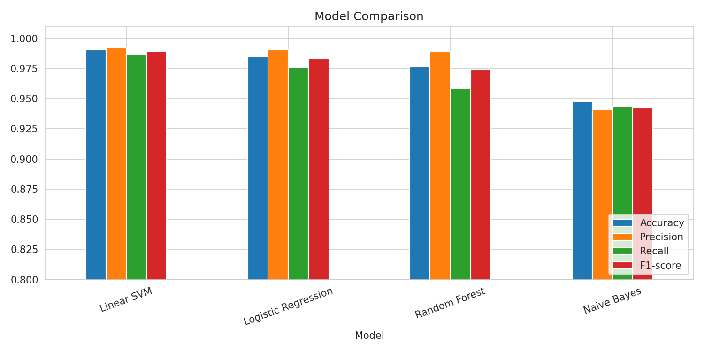
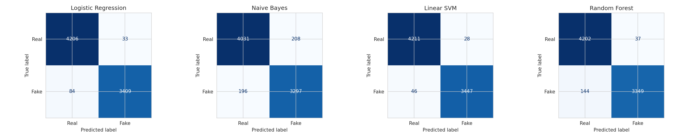
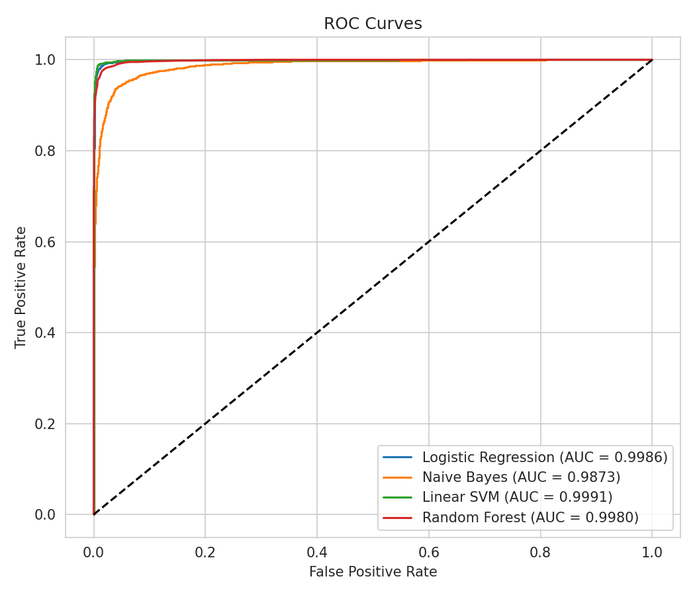

# 📰 Fake News Detector (NLP)

A machine learning project that classifies English news articles as **Real** or **Fake** using TF-IDF features and classical ML models.

## Dataset
[Fake and Real News Dataset](https://www.kaggle.com/datasets/clmentbisaillon/fake-and-real-news-dataset) (Kaggle), around 44k articles.

## Pipeline
1. Data loading and duplicate removal
2. EDA (class balance, article length, word clouds)
3. Text cleaning (with removal of the "Reuters" data-leakage pattern)
4. TF-IDF features (unigrams + bigrams)
5. Models: Logistic Regression, Naive Bayes, Linear SVM, Random Forest
6. Evaluation: Accuracy, Precision, Recall, F1, Confusion Matrix, ROC
7. Error analysis
8. Gradio demo

## Results
| Model | Accuracy | Precision | Recall | F1 |
|---|---|---|---|---|
| Logistic Regression | _fill_ | _fill_ | _fill_ | _fill_ |
| Naive Bayes | _fill_ | _fill_ | _fill_ | _fill_ |
| Linear SVM | _fill_ | _fill_ | _fill_ | _fill_ |
| Random Forest | _fill_ | _fill_ | _fill_ | _fill_ |

## Key learnings
- Raw dataset leaks the label via publisher tags; removing them gives a more honest score.
- Limitations: English only, one dataset (US politics, 2016-17), model learns writing style rather than verifying facts.

## Future work
- Fine-tune DistilBERT/BERT
- Urdu fake news detection
- Cross-dataset testing

## Run it
Click the Colab badge and choose **Runtime → Run all**.
